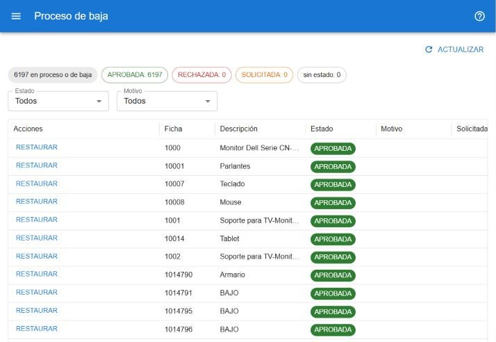

# Bajas

Dar de baja un bien lo pasa a inactivo. Según los permisos, la baja se hace en uno o dos pasos.

## Quién hace qué

| Permiso | Puede |
|---|---|
| Guardar | **Solicitar baja**: el bien queda en *Baja en trámite* y sigue activo hasta que alguien la apruebe. |
| Aprobar bajas | **Dar de baja** directamente, o **Aprobar** / **Rechazar** una baja solicitada. |
| Restaurar bajas | **Restaurar** un bien dado de baja: vuelve a estar activo y la baja anterior queda registrada. |

## Solicitar o dar de baja

Desde la [ficha](#ayuda/ficha) (botones en la solapa Datos) o desde la [búsqueda](#ayuda/busqueda) con varios bienes seleccionados:

1. Pulsá **Solicitar baja** o **Dar de baja**.
2. Elegí el **Motivo de la baja**.
3. Confirmá.

Al aprobar o dar de baja desde la ficha se puede elegir un **Adjunto de respaldo** entre los archivos de la solapa Adjuntos del bien (por ejemplo, el acta de baja). Conviene subirlo antes.

Rechazar pide un motivo; restaurar lo admite como opcional.

## Proceso de baja

En **operaciones → proceso de baja** está el seguimiento de todos los bienes con alguna baja. [Abrir el proceso de baja](#w=bajas)

- Los chips cuentan los bienes por estado de la baja (*solicitada*, *aprobada*, *rechazada*, sin estado). Tocá uno para filtrar.
- También se puede filtrar por **Estado**, **Motivo**, **Categoría** y **Subcategoría** (sólo las de la categoría elegida).
- La columna **Acciones** tiene los botones que correspondan a cada bien.
- Tocá una fila para abrir la ficha del bien.

Cada cambio de estado de una baja aparece también en el [calendario](#ayuda/calendario).
