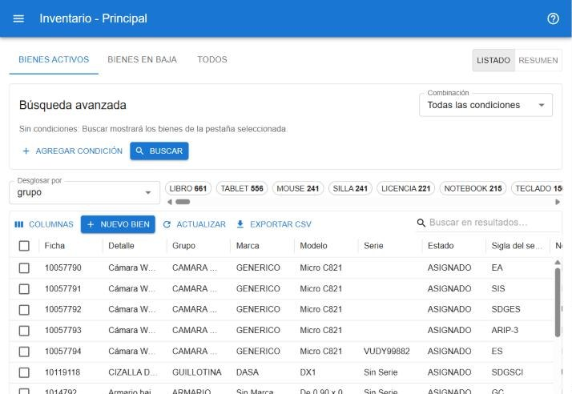
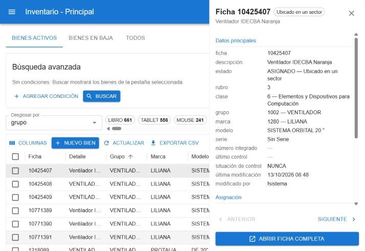

# Buscar bienes

La pantalla **principal** es el punto de partida: buscar bienes, ver sus datos y operar sobre uno o varios. [Abrir la búsqueda](#w=principal)

## Pestañas

- **Bienes activos**: los que están en alta.
- **Bienes en baja** y **Todos**: aparecen sólo para quien gestiona bajas.

## Búsqueda rápida

El cuadro **Buscar en resultados…** de la barra del listado busca en todos los datos del bien a la vez: ficha, descripción, categoría, subcategoría, marca, modelo, serie, sector, responsable, etc. Por ejemplo, *notebook* o *computadoras* traen los bienes de esa subcategoría o categoría.

Los resultados aparecen en este orden:

1. El bien cuya ficha es exactamente lo que escribiste.
2. Los que coinciden en datos de identificación (ficha, serie, inventario, etc.). Al lado de la descripción se indica en qué dato coincidió.
3. El resto de las coincidencias.

## Búsqueda avanzada

Sirve para armar condiciones precisas.

1. Pulsá **Agregar condición**.
2. Elegí el **Campo o atributo**, el **Operador** y el **Valor**.
3. Repetí para sumar más condiciones y elegí en **Combinación** si tienen que cumplirse **Todas las condiciones** o **Alguna condición**.
4. Pulsá **Buscar**.

Operadores disponibles, según el tipo de campo: *Contiene*, *Es igual a*, *Es distinto de*, *Empieza con*, *Termina con*, *Está vacío*, *No está vacío*, *Es mayor / menor que*, *Está entre* y *Es alguno de*.

- **Es alguno de** permite elegir varios valores de una lista (por ejemplo, varios sectores, categorías o grupos). Está disponible en los campos del resumen y en los atributos.
- **Contiene** en un campo como *Sector* busca también en la sigla y el nombre del sector.

> Si cambiás las condiciones y no pulsás **Buscar**, aparece el aviso *Hay cambios en los filtros sin aplicar*.

Arriba del listado se ven como chips los **Filtros aplicados**. Cada chip se quita con su cruz; **Limpiar todo** los saca todos.

## Desglose

La fila de chips arriba del listado muestra cuántos bienes hay por cada valor del campo elegido en **Desglosar por** (arranca en *categoría*; ver [Bienes por categoría](#ayuda/categorias)). Tocá un chip para ver sólo esos bienes; volvé a tocarlo para quitar el filtro. La suma de los chips es el total del listado.

## Resumen

El botón **Resumen** (arriba a la derecha) muestra los bienes agrupados.

- Elegí el campo en **Agrupar por** y, si querés, sumá más con **Agregar campo** (hasta cinco).
- Cada fila muestra la **Cantidad** de bienes del grupo.
- Tocá una fila para ver el listado de esos bienes. Desde el listado, **Volver al resumen** regresa al cuadro.

## Columnas

- Con el botón **Columnas** elegís qué columnas ver. La elección queda guardada en tu navegador.
- **Restablecer columnas** vuelve a las columnas iniciales.
- Los valores con código se muestran sin él; pasando el mouse se ve el valor completo.

## Vista rápida

Hacé clic en una fila (o pulsá **Enter** sobre ella) para abrir un panel lateral con la foto, los datos principales y la asignación del bien. Con **Anterior** y **Siguiente** recorrés el listado sin cerrar el panel, y **Abrir ficha completa** lleva a la [ficha](#ayuda/ficha).

## Acciones de la barra

Sin bienes seleccionados:

- **Nuevo bien**: abre una ficha vacía para el alta (requiere permiso para guardar).
- **Actualizar**: vuelve a consultar.
- **Exportar CSV**: descarga el resultado de la búsqueda.

Con bienes seleccionados (casilla a la izquierda de cada fila):

- **Imprimir códigos de barra**: genera las etiquetas de los bienes elegidos.
- **Editar**: cambia uno o más campos en todos los bienes seleccionados. Ver *Edición masiva* más abajo.
- **Solicitar baja** o **Dar de baja**: ver [Bajas](#ayuda/bajas).
- **Mover**: ver [Mover bienes](#ayuda/mover).
- **Quitar selección**.

## Edición masiva

1. Seleccioná los bienes y pulsá **Editar**.
2. Agregá cada campo a cambiar, con su **Nuevo valor**, o marcá **Vaciar** para dejarlo en blanco.
3. Pulsá **Previsualizar** para ver cuántos bienes cambian realmente.
4. Pulsá **Aplicar**.

Sólo se modifican los campos que agregues; el resto queda como está.
