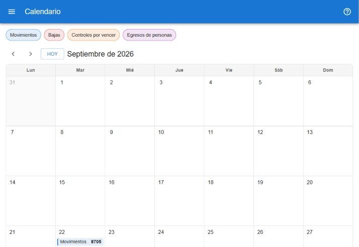

# Calendario

El calendario muestra por fecha lo que pasó (o va a pasar) con los bienes. Requiere permiso para guardar. [Abrir el calendario](#w=calendario)

## Tipos de evento

| Tipo | Qué muestra |
|---|---|
| **Movimientos** | Los bienes movidos cada día, agrupados por solicitud. |
| **Bajas** | Cada paso de una baja: solicitada, aprobada, rechazada, restaurada. |
| **Controles por vencer** | El día en que vence el control de cada bien (último control más el plazo de vigencia). |
| **Egresos** | Personas que egresan según siper y tienen bienes a cargo. Es sólo un aviso: no cambia nada en el inventario. |

La leyenda de arriba permite ocultar o mostrar cada tipo tocándolo. Los nombres, el orden y los colores se configuran en **configuración → tipos de evento del calendario**.

## Vista mes

Cada día muestra la cantidad de eventos de cada tipo. Con las flechas se cambia de mes y **Hoy** vuelve al mes actual. Tocá un día para verlo en detalle.

## Vista día

- Los eventos del día agrupados por tipo y, dentro de cada tipo, por solicitud, paso o persona, con la cantidad de bienes y los usuarios que intervinieron.
- Cada grupo lista sus bienes, con columnas según el tipo: de dónde a dónde en los movimientos; hora, motivo y respaldo en las bajas; último control en los controles; a cargo como qué en los egresos.
- La ficha de cada bien se abre desde la tabla; en los movimientos, **Abrir solicitud** lleva a la solicitud.
- Con las flechas se pasa al día anterior o siguiente; **Ver el mes** vuelve a la vista mes.
