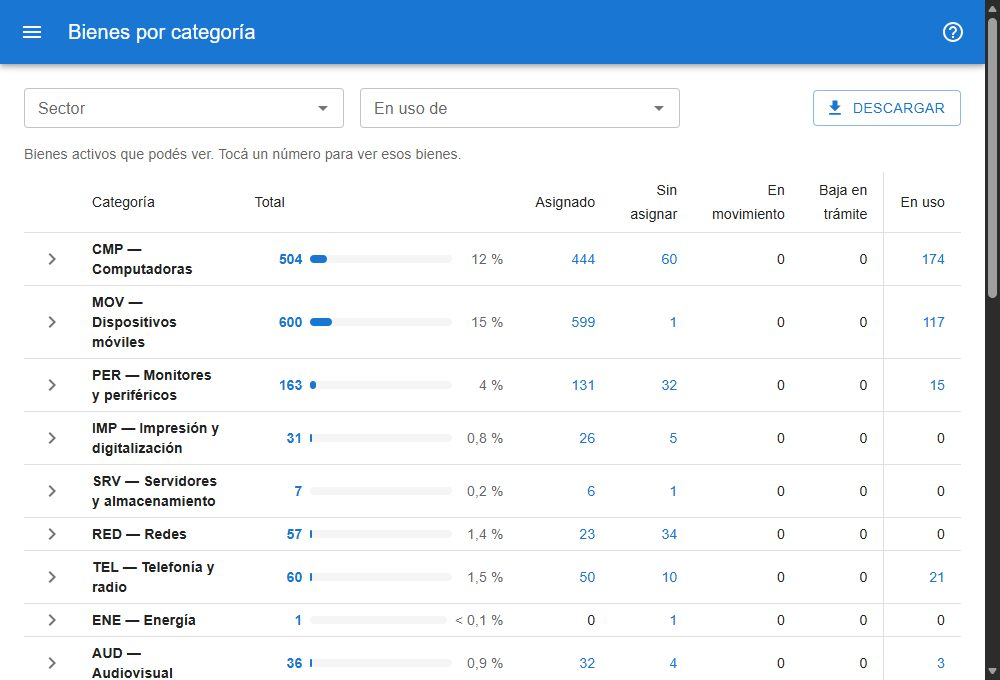

# Bienes por categoría

Muestra en una sola tabla cuántos bienes activos hay de cada tipo y en qué estado están. Está en **reportes → bienes por categoría**, para todos los usuarios. [Abrir el reporte](#w=bienes_por_categoria)

## Categoría y subcategoría

Cada bien tiene una clasificación de dos niveles:

- La **subcategoría** es el tipo de bien: *Notebook*, *Tablet*, *Silla*…
- La **categoría** agrupa subcategorías por función: *Computadoras*, *Dispositivos móviles*, *Mobiliario*…

La **subcategoría** es un dato de cada bien: se elige en la ficha (sección *Clasificación*), en el alta y en la edición masiva, y se copia al clonar. La **categoría** no se elige: es la de la subcategoría.

El grupo es independiente: cambiar el grupo de un bien no cambia su subcategoría. Al cargar la clasificación por primera vez, cada bien tomó la subcategoría equivalente a su grupo; esa equivalencia queda como referencia en **gestion de datos → grupos** (*subcategoría equivalente*). Los catálogos están en **gestion de datos → categorías** y **subcategorías**.

La categoría y la subcategoría también se ven en la [ficha](#ayuda/ficha) y como columnas y filtros en la [búsqueda](#ayuda/busqueda).

## Cómo se lee

- Una fila por categoría, con el **Total**, una barra y el porcentaje que esa categoría representa sobre el **Total general**.
- Las columnas siguientes reparten el total por estado del bien: **Asignado**, **Sin asignar**, **En movimiento** y **Baja en trámite**.
- La última, **En uso**, separada por una línea, cuenta los bienes cuyo último movimiento tiene cargado un **responsable de uso** (la persona elegida en *en uso de*).
- La flecha de la izquierda abre la categoría en sus subcategorías.
- **Sin categoría** reúne los bienes que todavía no tienen subcategoría.
- *Accesorios y componentes* (mouse, teclados, memorias…) es una categoría más, con las demás.
- El **Total general** coincide con la cantidad de bienes activos.
- Si en el catálogo una categoría se marca como *aparte*, va abajo, con su propio total, y no suma al **Total principal**; el **Total general** sigue sumando todo. Hoy no hay ninguna marcada.

## Qué significa cada estado

El estado del bien no se carga a mano: lo calcula el sistema, y cada bien está en uno solo. Si se cumplen varias condiciones, vale la primera de esta lista:

1. **Baja en trámite**: se pidió la baja del bien y todavía no se aprobó ni se rechazó.
2. **En movimiento**: el bien está en una solicitud de movimiento que ya se envió y todavía no se procesó. Las solicitudes en borrador no cuentan.
3. **Asignado**: su último movimiento lo deja en un sector o a cargo de un responsable directo.
4. **Sin asignar**: su último movimiento no tiene sector ni responsable, o nunca se movió.

Los bienes dados de baja no aparecen en este reporte, que cuenta sólo los activos.

**En uso** no es un estado: cuenta los bienes cuyo último movimiento tiene un **responsable de uso** cargado, sin importar su estado. Si en *en uso de* sólo se escribió un texto (un lugar o una aclaración) y no se eligió una persona, el bien no se cuenta. Por eso esa columna no suma con las demás.

Pasando el mouse por el título de cada columna se ve un resumen de su definición.

## Ver los bienes de un número

Tocá cualquier número para abrir la búsqueda con esos bienes: por ejemplo, el de *Notebook* en la columna *Sin asignar* abre la búsqueda filtrada por *subcategoría: Notebook · estado: Sin asignar*, y el total del listado es el mismo número. El filtro se quita desde **Filtros aplicados**.

## Sector, en uso de y descarga

- **Sector** limita todas las cantidades a los bienes de ese sector (sin los sectores que dependen de él). Ofrece sólo los sectores activos, con su responsable al lado, así también se lo encuentra escribiendo el apellido.
- **En uso de** limita las cantidades a los bienes que una persona tiene en uso. La lista muestra sólo a quienes tienen bienes activos en uso (del sector elegido, si hay uno), con su cantidad.
- Los dos se pueden combinar, y viajan a la búsqueda al tocar un número.
- **Descargar** baja la tabla como planilla, con una fila por subcategoría.

Cada usuario ve en el reporte sólo los bienes que puede ver en la búsqueda.
