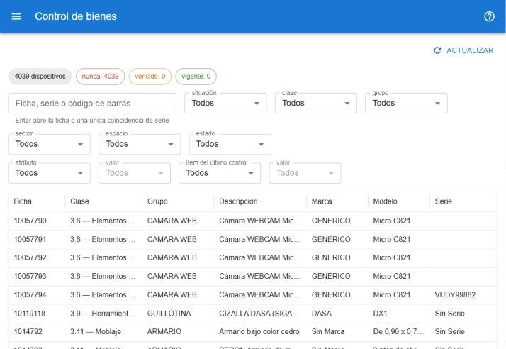
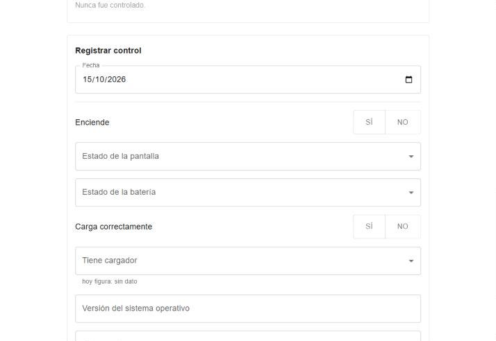

# Control de bienes

El control registra la verificación física de un bien: que está, en qué estado y con qué accesorios. Está en **operaciones → control de bienes** y requiere permiso para controlar. [Abrir el control de bienes](#w=controles)

## Situación de cada bien

| Situación | Significa |
|---|---|
| **nunca** | El bien no tiene ningún control registrado. |
| **vencido** | El último control superó el plazo de vigencia (un año, salvo que se configure otro). |
| **vigente** | El último control está dentro del plazo. |

## Listado

- Los chips cuentan los bienes por situación; tocá uno para filtrar.
- El cuadro **Ficha, serie o código de barras** acepta lo que se escriba o lo que lea un lector de códigos de barras. Con **Enter** abre directamente la ficha, o el bien si hay una sola coincidencia de serie.
- Se puede filtrar por situación, clase, categoría, subcategoría (sólo las de la categoría elegida), grupo, sector, espacio y estado, por un **atributo** y su valor, y por un **ítem del último control** y su valor (por ejemplo, ver todos los que tenían un accesorio faltante).
- Tocá una fila para controlar ese bien. Al volver, el listado conserva filtros y página.

## Registrar un control

Al abrir un bien se ven:

- **Estado actual**: los datos principales, la asignación, los atributos y el resultado del último control.
- **Registrar control**: la **Fecha**, un valor por cada ítem de control que corresponde a ese tipo de bien y una **Observación**.
  - **Copiar último control** completa los ítems con los valores del control anterior; después se cambia sólo lo que difiera.
  - En los ítems de accesorios se muestra lo que *hoy figura* en el bien. Si el control queda como el último del bien, el valor elegido actualiza el atributo; dejarlo vacío no lo cambia.

- **Guardar** registra el control. **Guardar y siguiente** lo registra y pasa al próximo bien del listado, para controlar en serie.
- **Historial de controles**: los controles anteriores del bien.

La fecha y la situación del último control también están como columnas en la [búsqueda de bienes](#ayuda/busqueda), y los controles por vencer aparecen en el [calendario](#ayuda/calendario).
