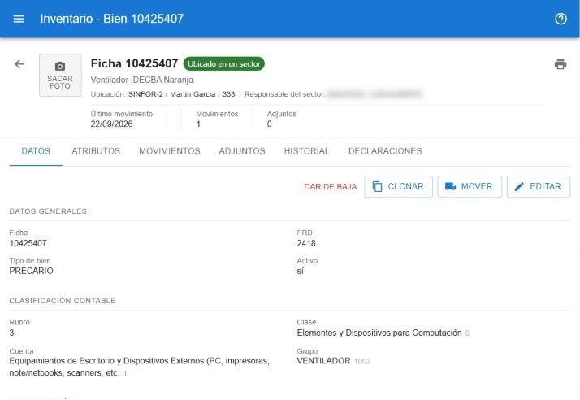

# Ficha del bien

La ficha reúne todo lo que se sabe de un bien. Se abre desde la [búsqueda](#ayuda/busqueda), desde la vista rápida, o desde otras pantallas que muestran bienes.

## Encabezado

Muestra la foto, la ficha, el estado, la descripción y la asignación actual: **Ubicación**, **Responsable del sector**, **Responsable directo** y **Tipo de asignación**. Debajo, un resumen con el último movimiento, la última declaración y la cantidad de movimientos y adjuntos.

- La flecha de la izquierda vuelve a la búsqueda.
- El botón de impresora imprime la etiqueta con el código de barras.

### Foto

Tocá la miniatura para verla en grande. Con **Sacar foto** se carga una nueva: en el teléfono abre la cámara; en la computadora, el selector de archivos. La foto se achica automáticamente antes de subirla. El bien muestra siempre la última foto cargada; si se borra, vuelve a mostrar la anterior.

## Solapa Datos

Muestra los datos del bien. Arriba están las acciones disponibles:

- **Editar**: abre los datos agrupados en secciones (*Datos generales*, *Clasificación*, *Clasificación contable*, *Identificación*, *Compra*, *Información adicional* y *Otros datos*). Pulsá **Guardar** para confirmar o **Cancelar** para descartar. En *Clasificación* se elige la subcategoría; la categoría se completa sola y no se edita (ver [Bienes por categoría](#ayuda/categorias)).
- **Mover**: ver [Mover bienes](#ayuda/mover). Sólo en bienes activos y con permiso para mover.
- **Clonar**: abre el alta de un bien nuevo con los datos de este ya cargados, para dar de alta bienes parecidos sin tipear todo.
- **Solicitar baja**, **Dar de baja**, **Aprobar**, **Rechazar** o **Restaurar**: ver [Bajas](#ayuda/bajas).

Mientras haya cambios sin guardar se ve el aviso *Cambios sin guardar*.

## Otras solapas

| Solapa | Contenido |
|---|---|
| **Atributos** | Características adicionales del bien (por ejemplo, accesorios). Con **Asignar atributo** se agrega uno. |
| **Movimientos** | Todos los movimientos del bien. Si vino de una solicitud, se puede abrir desde la columna correspondiente. |
| **Adjuntos** | Archivos asociados al bien: subir, descargar y eliminar. |
| **Historial** | Línea de tiempo con los cambios de datos (valor anterior y nuevo), movimientos y controles. |
| **Declaraciones** | Las declaraciones en las que figura el bien. Ver [Declaraciones](#ayuda/declaraciones). |

Las solapas se habilitan una vez guardado el bien.

## Alta de un bien

1. En la búsqueda, pulsá **Nuevo bien** (o **Clonar** desde una ficha).
2. Completá los datos. Para el número de ficha, el botón **Sugerir** propone uno.
3. Pulsá **Guardar**.

El estado no se carga: lo calcula el sistema según sus movimientos. Para asignarlo a un sector o responsable, usá [Mover](#ayuda/mover).
