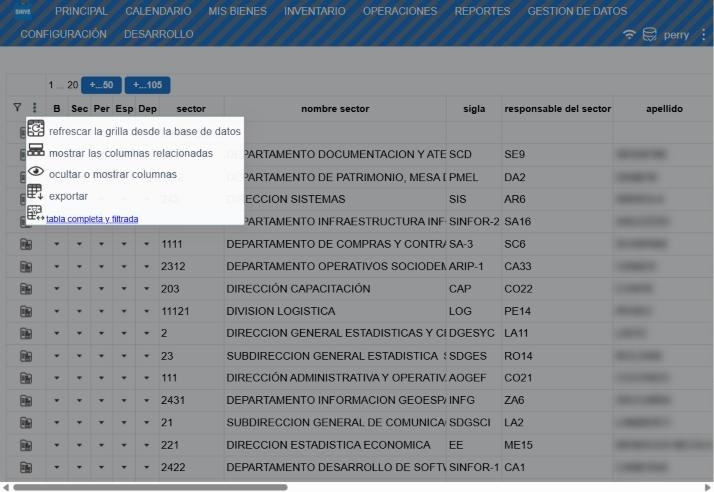

# Grillas y reportes

Muchas opciones del menú (**inventario**, **mis bienes**, **reportes**, **gestion de datos**, **configuración**) abren una grilla: una tabla con todas las filas de un tipo de dato.

## Reportes

| Reporte | Muestra |
|---|---|
| **bienes por sector** | Cantidad de bienes de cada sector. |
| **bienes por responsable** | Cantidad de bienes a cargo y en uso de cada persona. |
| **bienes por espacio** | Cantidad de bienes de cada espacio físico. |
| **parque tecnológico** | Los equipos informáticos, con su último control. |
| **consulta de movimientos** | Ver [Consulta de movimientos](#ayuda/movimientos). |

## Usar una grilla

- **Más filas**: la grilla trae las primeras filas; los botones de arriba (por ejemplo **+...50**) cargan más o todas.
- **Filtrar**: el botón del embudo, arriba a la izquierda, agrega una fila de filtros sobre las columnas; escribí en la columna que quieras. El mismo lugar permite sumar otra fila de filtro (se muestran las filas que cumplen alguna) o quitar el filtro.
- **Ordenar**: tocá el encabezado de la columna.
- **Opciones** (botón **⋮**): refrescar desde la base, mostrar las columnas relacionadas, ocultar o mostrar columnas y **exportar** la tabla completa y filtrada.
- **Ver el detalle**: las columnas angostas con **▾** (por ejemplo, *Sec*, *Per* o *Esp*) despliegan debajo de la fila los datos relacionados.
- **Ver como ficha**: el ícono al comienzo de cada fila la abre en forma de ficha.
- **Editar**: si tu rol lo permite, los valores se cambian directamente en la celda y se guardan al salir de ella.

Para buscar y operar sobre bienes es más cómoda la pantalla [principal](#ayuda/busqueda); las grillas sirven para consultas y para mantener catálogos.
