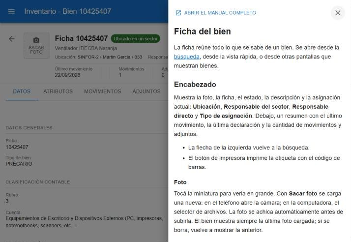

# Primeros pasos

El sistema de inventario registra los bienes del Instituto: qué son, dónde están, quién los tiene a cargo, cómo se mueven y cuándo se dan de baja.

## El menú

Al ingresar se ve el menú principal. Cada persona ve sólo las opciones que su rol le permite.

| Opción | Para qué sirve |
|---|---|
| **principal** | Buscar bienes y abrir su ficha. Ver [Buscar bienes](#ayuda/busqueda). |
| **calendario** | Ver por fecha los movimientos, las bajas y los controles por vencer. Ver [Calendario](#ayuda/calendario). |
| **mis bienes** | Los bienes que tenés a tu cargo y los que están en uso tuyo. |
| **inventario** | Las grillas completas de bienes: todos, en alta y en baja. |
| **operaciones** | Declaraciones, solicitudes de movimiento, proceso de baja y control de bienes. |
| **reportes** | Bienes por categoría, por sector, por responsable, por atributos y por espacio, y consulta de movimientos. |
| **gestion de datos** | Sectores, responsables, espacios y demás catálogos (sólo con permiso para gestionar datos). |
| **ayuda** | Este manual. |

En cada pantalla, el botón **☰** de la barra superior abre un panel con las mismas opciones del menú, para ir directo a otra pantalla o volver al menú principal, y el botón **?** abre la ayuda de esa pantalla en un panel lateral sin perder lo que estabas haciendo.

## Qué puede hacer cada persona

Lo que se puede hacer depende de los permisos del rol, que define el administrador:

| Permiso | Habilita |
|---|---|
| Guardar | Dar de alta y editar bienes, crear solicitudes de movimiento, emitir documentos, solicitar bajas. |
| Mover | El botón **Mover** en la búsqueda y en la ficha. |
| Aprobar bajas | Aprobar o rechazar bajas solicitadas, y dar de baja directamente. |
| Restaurar bajas | Volver a activar un bien dado de baja. |
| Controlar | Registrar controles físicos de los bienes. |
| Gestionar datos | Mantener sectores, responsables, espacios y catálogos. |

Si no ves un botón que esperabas, lo más probable es que tu rol no tenga ese permiso o que el bien esté en un estado que no lo admite (por ejemplo, dado de baja).

## Estado del bien

El estado lo calcula el sistema; no se edita a mano.

| Estado | Significa |
|---|---|
| **Asignado** | Su último movimiento le dio un sector o un responsable directo. |
| **Sin asignar** | Todavía no tiene sector ni responsable. |
| **En movimiento** | Está en una solicitud de movimiento que todavía no se procesó. |
| **Baja en trámite** | Alguien solicitó su baja y falta aprobarla. |
| **Baja** | Está dado de baja (inactivo). |

## Cambios sin guardar

Si estás editando algo y querés salir (volver al menú, a la búsqueda o a otra pantalla), el sistema pide confirmación antes de descartar los cambios.
