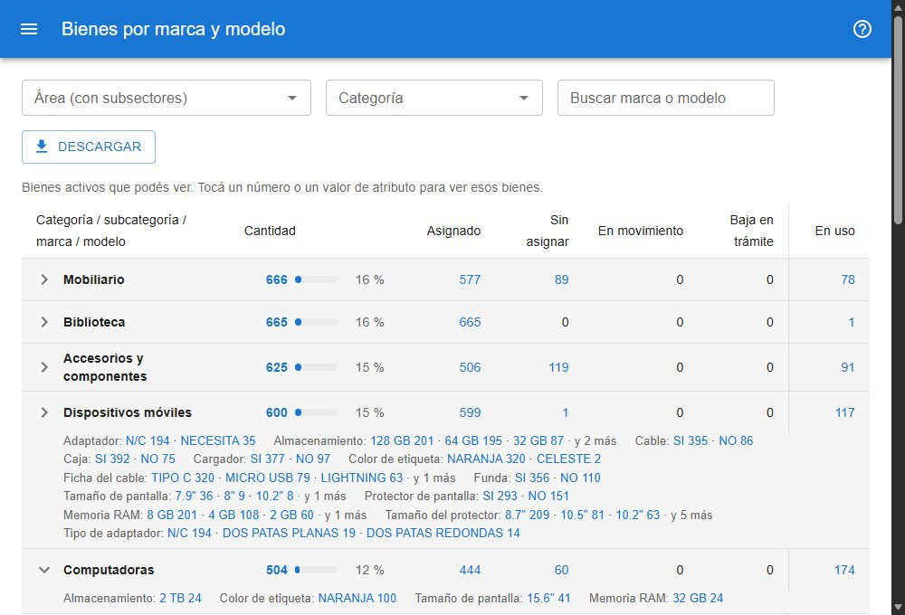

# Bienes por atributos

Muestra cuántos bienes activos hay de cada categoría y subcategoría, y deja filtrarlos por marca y por cualquier atributo cargado (memoria, almacenamiento, accesorios), tildando valores como en una tienda. Sirve para decidir compras y reasignaciones. Está en **reportes → bienes por atributos**, para todos los usuarios. [Abrir el reporte](#w=bienes_por_modelo)

## La tabla

Cada categoría es una fila sombreada, en el mismo orden que en el reporte por categoría, y debajo van sus subcategorías, de mayor a menor.

- **Cantidad**: los bienes de esa fila, con una barra y el porcentaje sobre el **Total** de la tabla.
- **Asignado** y **Sin asignar**: reparten la cantidad por estado (ver [qué significa cada estado](#ayuda/categorias)).
- **En uso**, separada por una línea: los que tienen cargado un responsable de uso; no suma con los estados.
- **Comodato** y **Acta**, separadas por otra línea: los que tienen ese tipo de asignación en su último movimiento; tampoco suman con los estados.

Los bienes que no tienen subcategoría van a **Sin categoría**, así los totales siempre cierran.

## Filtros

- **Área (con subsectores)**: cuenta sólo los bienes del área elegida y de todos sus subsectores. Ofrece las áreas activas, con su responsable.
- **Categoría** y **Subcategoría**: limitan la tabla. La subcategoría ofrece sólo las de la categoría elegida; elegir una subcategoría completa su categoría.

### Filtrar por marca y atributos

La columna **Filtrar**, a la izquierda de la tabla, muestra todo lo que hay en el inventario con los filtros de arriba: la **Marca** y cada atributo que algún bien tenga cargado, con todos sus valores y cuántos bienes tienen cada uno, de mayor a menor, y **(sin dato)** al final. Se ven los ocho valores con más bienes; **Ver todos** muestra el resto. En pantallas angostas (el teléfono o una ventana chica) la columna se abre con el botón **Filtrar**, arriba de la tabla.

Tildá los valores que querés ver. Varios valores del mismo campo suman (una *Lenovo* **o** una *HP*); valores de campos distintos se combinan (Lenovo o HP, **y** con 4 GB de memoria, **y** con 64 GB de almacenamiento). Por ejemplo, para ver las tablets de una marca con una capacidad y una memoria determinadas: elegí la subcategoría *Tablet* arriba y tildá la marca, el almacenamiento y la memoria.

Cada vez que tildás algo, las cantidades de los otros campos se recalculan con lo tildado. Las de un campo con algo tildado no cambian por lo tildado en ese mismo campo, así se puede sumar otro valor sin destildar. **Limpiar** destilda todo.

Todos los filtros cambian todas las cantidades.

## Ver los bienes de un número

Tocá cualquier número para abrir la [búsqueda](#ayuda/busqueda) con esos bienes: la fila (categoría o subcategoría), los filtros de arriba y el estado de la columna, *en uso* o el tipo de asignación. Lo tildado en **Filtrar** llega como condiciones *es alguno de* de la búsqueda avanzada, una por campo, que se pueden cambiar ahí. El total del listado es el mismo número, y cada filtro figura en **Filtros aplicados**, desde donde se puede quitar. Los números de **Otros** no llevan a la búsqueda.

## Descargar

**Descargar** baja una planilla con una fila por subcategoría: categoría, subcategoría, total, una columna por estado, **En uso**, **Comodato** y **Acta**, con los filtros elegidos y lo tildado. Se abre en Excel con los acentos correctos.
