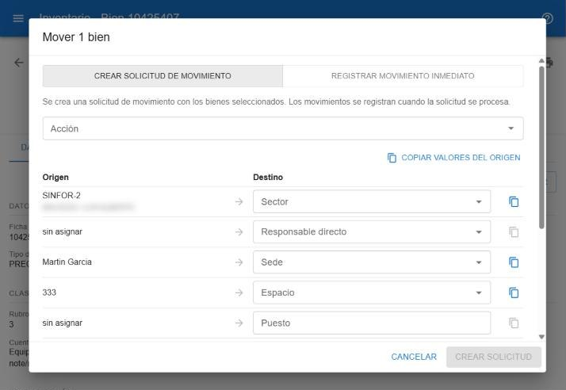

# Mover bienes

Mover cambia la asignación de uno o varios bienes: responsable, sector, sede, espacio y demás datos del destino. Requiere el permiso para mover.

## Desde dónde

- En la [búsqueda](#ayuda/busqueda): seleccioná los bienes y pulsá **Mover**.
- En la [ficha](#ayuda/ficha): botón **Mover** (sólo bienes activos).

## Dos formas de mover

| Opción | Qué pasa |
|---|---|
| **Registrar movimiento inmediato** | El destino se aplica en el momento y queda registrado en el historial de cada bien. |
| **Crear solicitud de movimiento** | Se crea una solicitud con los bienes elegidos. Los bienes quedan *En movimiento* y el cambio se registra cuando la solicitud se procesa. Es la forma habitual cuando hace falta documentación (comodato, acta de entrega). Ver [Solicitudes de movimiento](#ayuda/solicitudes). |

## Completar el destino

El diálogo muestra, campo por campo, el **Origen** (cómo está hoy) y el **Destino** (cómo va a quedar).

- El botón de copiar al lado de cada campo pasa el valor de origen al destino. Si los bienes tienen orígenes distintos, no se puede copiar.
- **Copiar valores del origen** copia todos los campos a la vez; después cambiás sólo lo que corresponde.
- **Detalle** es un texto libre que acompaña al movimiento.
- Hay que indicar al menos un dato de destino: responsable, sector, sede o espacio.

Al confirmar aparece un aviso con el resultado; si se creó una solicitud, el aviso permite abrirla.

> Un responsable dado de baja (inactivo) no aparece en los selectores y no se le pueden asignar bienes.
