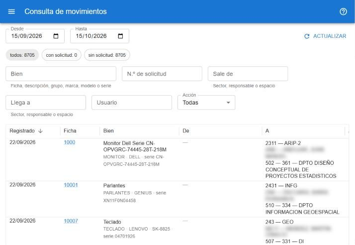

# Consulta de movimientos

Lista todos los movimientos de bienes, hayan salido de una solicitud o se hayan registrado en forma inmediata. Es sólo de consulta. Está en **reportes → consulta de movimientos**. [Abrir la consulta](#w=movimientos)

## Cómo se lee

Cada fila es un bien movido: cuándo se registró, la ficha y descripción, **De** (dónde estaba antes) y **A** (dónde quedó), la acción, el usuario y, si corresponde, la solicitud de origen, que se puede abrir tocando su número.

## Filtros

- **Desde** y **Hasta** limitan el rango de fechas.
- **Bien** busca por ficha, descripción, grupo, marca, modelo o serie.
- **N.º de solicitud**, **Sale de** y **Llega a** (sector, responsable o espacio), **Usuario** y **Acción**.
- Los chips separan los movimientos **con solicitud** y **sin solicitud**.

Los sectores se muestran con la sigla y el nombre que tenían cuando se registró el movimiento, aunque después hayan cambiado.

Para exportar o filtrar con más detalle está **reportes → movimientos (grilla)**; ver [Grillas y reportes](#ayuda/grillas).
