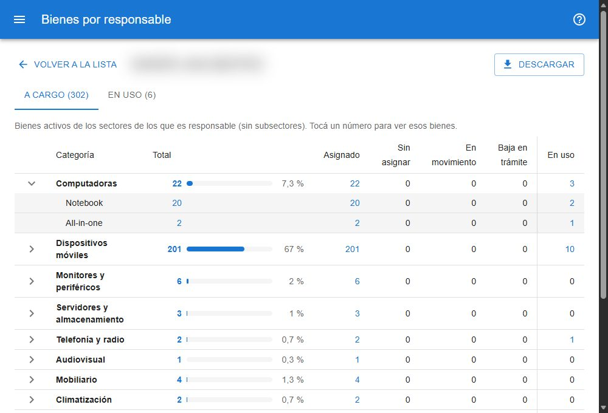

# Bienes por responsable

Muestra, para cada persona, cuántos bienes activos tiene a cargo y en uso, y permite ver esos bienes agrupados por categoría y subcategoría. Está en **reportes → bienes por responsable**, para todos los usuarios. [Abrir el reporte](#w=bienes_por_responsable)

## La lista

Una fila por persona con bienes, ordenada por la cantidad a cargo:

- **A cargo**: bienes de los sectores de los que es responsable (sin contar los subsectores).
- **En uso**: bienes que tiene en uso (es el *responsable de uso* del último movimiento).
- **Bienes de sectores a cargo**: los bienes de sus sectores sumando todos los subsectores.
- **Personas a cargo**, **Sectores** y **Sedes**.

**Sin responsable** reúne los bienes de sectores que no tienen responsable, y los que no tienen sector.

El cuadro **Buscar responsable** filtra por apellido, nombre o código, sin importar acentos ni mayúsculas.

## Los bienes de una persona

Tocá una fila para ver sus bienes con la misma tabla que [Bienes por categoría](#ayuda/categorias): una fila por categoría, que se abre en sus subcategorías, con el total, el porcentaje, las columnas por estado y **En uso**.

- Las solapas **A cargo** y **En uso** eligen qué bienes se muestran; cada una indica su cantidad.
- Tocá cualquier número para abrir la búsqueda con esos bienes, ya filtrada por la persona.
- **Descargar** baja la tabla como planilla.
- **Volver a la lista** regresa a la lista con la búsqueda y la página como estaban.
