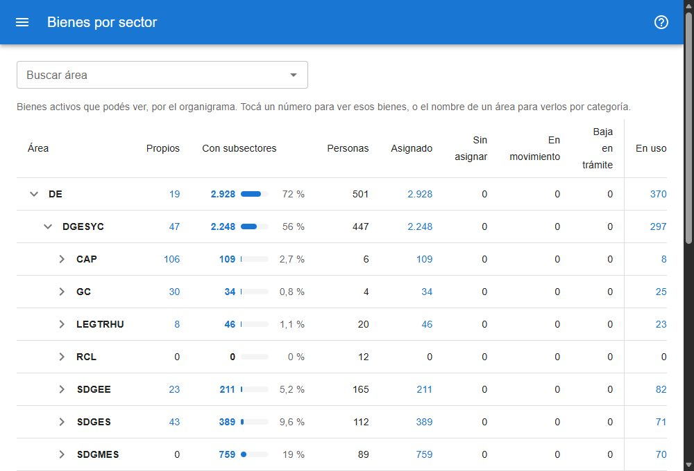

# Bienes por sector

Muestra los bienes activos siguiendo el organigrama: qué tiene cada área, sumando todos sus subsectores, y en qué estado están. Está en **reportes → bienes por sector**, para todos los usuarios. [Abrir el reporte](#w=bienes_por_sector)

## El árbol

Cada fila es un área del organigrama, con sus subsectores debajo. La flecha de la izquierda abre o cierra la rama; al entrar se ven abiertos los dos primeros niveles. En pantallas angostas el área se muestra sólo con su sigla; el nombre completo aparece al pasar el mouse.

- **Propios**: bienes del área, sin contar sus subsectores.
- **Con subsectores**: bienes del área y de todos los sectores que dependen de ella, a cualquier profundidad, con una barra y el porcentaje sobre el **Total general**.
- **Personas**: personas del área y de sus subsectores (las que tienen cargado su sector).
- **Asignado** y **Sin asignar**: reparten los bienes con subsectores por estado (ver [qué significa cada estado](#ayuda/categorias)).
- **En uso**, separada por una línea: los que tienen cargado un responsable de uso; no suma con los estados.
- **Comodato** y **Acta**, separadas por otra línea: los que tienen ese tipo de asignación en su último movimiento; tampoco suman con los estados.

**Sin sector** reúne los bienes activos que no tienen sector. Un sector dado de baja aparece, marcado como *inactivo*, sólo si todavía tiene bienes.

Cada usuario ve los bienes que puede ver en la búsqueda.

## Buscar un área

**Buscar área** encuentra por sigla o nombre, sin importar acentos ni mayúsculas. Al elegir una, el árbol se abre hasta ella y la marca.

## Ver los bienes de un número

Tocá cualquier número para abrir la búsqueda con esos bienes. Un número con subsectores filtra por **sector y subsectores: <sigla>**, que trae los bienes del área y de todo lo que depende de ella; el filtro se quita desde **Filtros aplicados**. El número de **Propios** filtra sólo por el área.

## Los bienes de un área por categoría

Tocá el nombre de un área para ver sus bienes con la misma tabla que [Bienes por categoría](#ayuda/categorias), con dos solapas: **Con subsectores** y **Sólo el área**, cada una con su cantidad. **Descargar** baja la tabla, y **Volver al organigrama** regresa con las mismas ramas abiertas.
