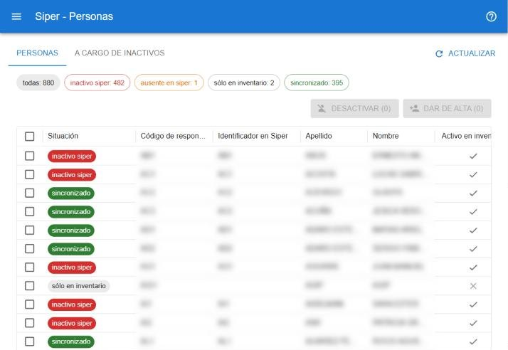

# Personas de siper

siper es el sistema de personal y la fuente de las personas. El inventario recibe sus datos, pero nunca escribe en siper. La pantalla está en **gestion de datos → siper → personas** y es sólo para administradores. [Abrir personas de siper](#w=siper)

## Solapa Personas

Cada persona con su **Situación**, que compara lo que dice siper con lo que tiene el inventario:

| Situación | Significa |
|---|---|
| **sincronizado** | Está igual en los dos. |
| **inactivo siper** | Egresó en siper pero sigue activo en el inventario. |
| **alta** | Está en siper y todavía no es responsable en el inventario. |
| **posible duplicado** | Viene de siper sin vínculo y coincide en apellido y nombre con un responsable cargado a mano. Conviene revisarlo antes de darlo de alta. |
| **ausente en siper** | Está vinculado con siper pero no vino en la última recepción. |
| **sólo en inventario** | Responsable cargado a mano, sin vínculo con siper. |
| **inactivo en inventario** | Fue desactivado en el inventario pero sigue activo en siper. |

Los chips filtran por situación. Las columnas muestran también cuántos bienes directos, bienes en uso y sectores tiene a cargo cada persona.

### Acciones

Seleccioná las personas con la casilla de cada fila:

- **dar de alta**: crea el responsable en el inventario con los datos de siper.
- **desactivar**: lo marca inactivo en el inventario. Antes de confirmar se muestra qué bienes y sectores siguen a su cargo.

Un responsable inactivo no se puede elegir en movimientos, solicitudes ni como jefe de sector.

## Solapa A cargo de inactivos

Los bienes y sectores que todavía figuran a cargo de responsables inactivos, para reasignarlos. **Abrir bien** lleva a la ficha, desde donde se puede [mover](#ayuda/mover).

Los egresos de personas con bienes a cargo también aparecen en el [calendario](#ayuda/calendario).
