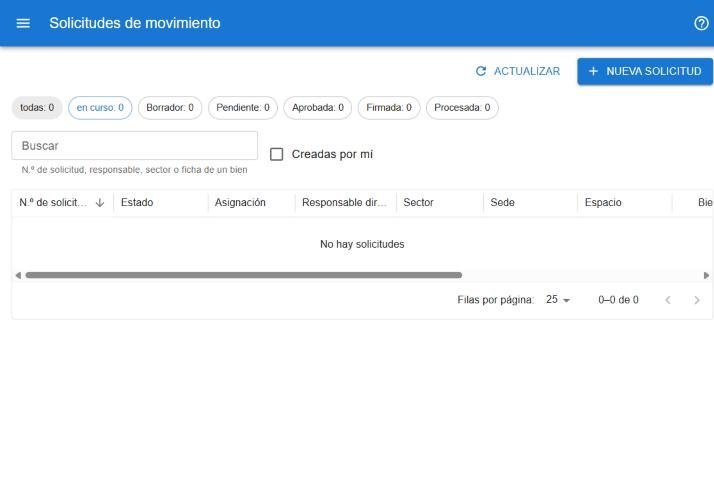
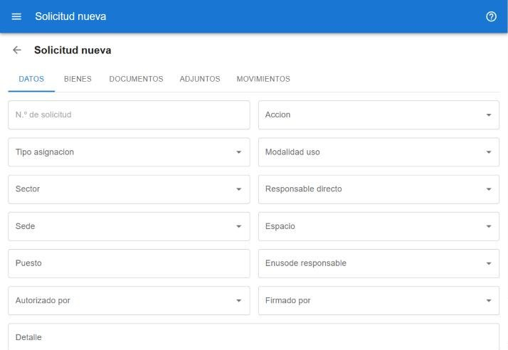

# Solicitudes de movimiento

Una solicitud agrupa los bienes que se entregan, devuelven o reasignan juntos, con su documentación. Los movimientos de los bienes se registran recién cuando la solicitud se procesa. Está en **operaciones → solicitudes de movimiento** y requiere permiso para guardar. [Abrir las solicitudes](#w=solicitudes)

## Listado

- Los chips de arriba cuentan las solicitudes: **todas**, **en curso** (las que todavía tienen alguna acción por hacer) y una por cada estado. Tocá un chip para filtrar.
- **Buscar** filtra por número de solicitud, responsable, sector o ficha de un bien.
- **Creadas por mí** muestra sólo las tuyas.
- La columna **Acciones** permite avanzar o retroceder una solicitud sin abrirla.
- Tocá una fila para abrir la solicitud. Al volver, el listado conserva los filtros.

## Crear una solicitud

Hay dos caminos:

- Desde el listado, con **Nueva solicitud**: se completan los datos y después se agregan los bienes.
- Desde la [búsqueda de bienes](#ayuda/busqueda): seleccionar los bienes, **Mover** y elegir **Crear solicitud de movimiento**. Ver [Mover bienes](#ayuda/mover).

## La solicitud

En el encabezado se ven el número, el estado y los botones de las acciones disponibles en ese estado (por ejemplo, enviar, aprobar, procesar o volver atrás). Los nombres y el orden de los estados los define la configuración del sistema. Algunas acciones piden confirmación.

> Antes de ejecutar una acción o emitir un documento hay que **Guardar** o descartar los cambios pendientes.

### Datos

El destino de los bienes: acción, tipo de asignación, modalidad de uso, sector, responsable, sede, espacio, puesto, persona que lo usa, quién autoriza, quién firma y un detalle libre.

Los datos se editan sólo mientras la solicitud está en **Borrador**. Si ya avanzó, el aviso indica qué botón usar para volverla atrás.

### Bienes

- **En la solicitud**: los bienes incluidos. El botón de quitar lo saca de la solicitud.
- **Agregar bienes**: una búsqueda igual a la [principal](#ayuda/busqueda). Seleccioná los bienes y pulsá **Agregar a la solicitud**. Los que ya están aparecen marcados y no se pueden volver a elegir.

Agregar o quitar bienes se guarda en el momento.

### Documentos

- **Emitir comodato** o **Emitir acta de entrega y devolución** generan el PDF con los bienes de la solicitud. En el acta se indica si documenta una *Entrega* o una *Devolución* y, si corresponde, en representación de quién se entrega o recibe (se elige de los responsables; vacío queda la línea de puntos).
- Cada emisión queda como una versión, con su código. **Descargar emitido** baja el PDF.
- Una vez firmado, **Subir documento recibido** carga el documento firmado; después se puede descargar o reemplazar.

### Adjuntos

Otros archivos relacionados con la solicitud. Se guardan en el momento.

### Movimientos

Los movimientos que generó la solicitud. Aparecen cuando la solicitud se procesa.
